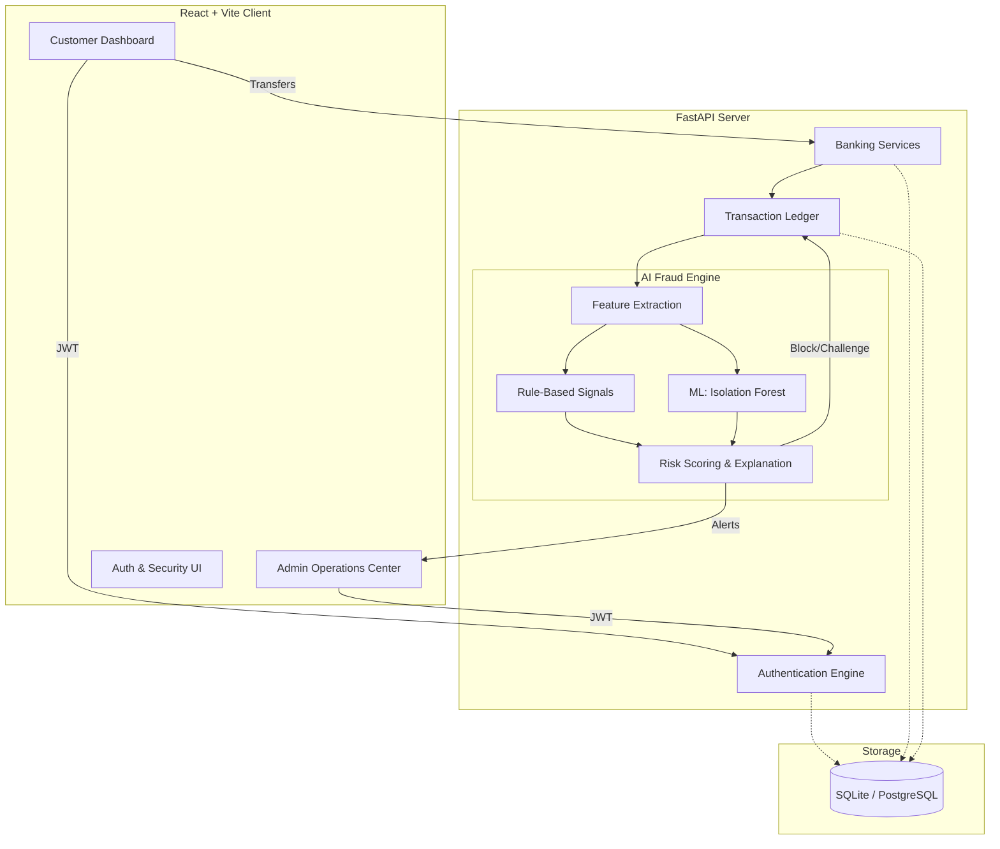

<div align="center">
  
  <h1>Global Digital Bank</h1>
  <p><b>AI-Powered Digital Banking & Explainable Fraud Prevention Platform</b></p>

  [](https://reactjs.org/)
  [](https://fastapi.tiangolo.com/)
  [](https://python.org/)
  [](https://tailwindcss.com/)
  [](https://scikit-learn.org/)
</div>

<br />

## 🌟 Project Overview

**Global Digital Bank** is a full-stack digital banking platform combining secure banking workflows with AI-powered transaction risk analysis and explainable fraud detection. 

Built to demonstrate modern enterprise fintech architecture, this platform offers a complete customer portal for managing accounts, transferring funds, and monitoring analytics, paired with a robust administrative dashboard for compliance officers to review AI-flagged transactions.

The core differentiator is the **Explainable AI (XAI)** fraud engine. Instead of simply blocking a transaction and returning a generic "Fraud Detected" error, the ML pipeline provides deterministic, interpretable signals (e.g., *“Transaction at 2:47 AM”*, *“Amount significantly above normal”*) so both the user and the compliance team understand exactly *why* a transaction was flagged.

---

## 🏗 Application Architecture



---

## ✨ Key Features

### 🏦 Customer Banking
- **Account Management:** Zero-balance savings, checking, and fixed deposit simulations.
- **Transfers & Payments:** Real-time inter-account and beneficiary transfers.
- **Bill Pay & Cards UI:** Mock UI implementations for utility payments and debit/credit card controls (freeze/unfreeze).
- **Smart Analytics:** Visual breakdowns of spending and income.
- **Notifications:** Real-time alerts for login events, deposits, and blocked transactions.

### 🛡️ Security & Authentication
- **Secure Auth:** JWT-based authentication with bcrypt password hashing.
- **Multi-Factor Elements:** Secondary 4-digit PIN required for sensitive actions (transfers, account deletion).
- **Audit Logging:** Immutable tracking of critical system events (logins, failed attempts, PIN changes).
- **Role-Based Access Control:** Strict separation between `customer` and `admin` API routes.

### 🕵️‍♂️ AI Fraud Detection
- **Real-Time Risk Scoring:** Every transfer is analyzed synchronously.
- **Behavioral Anomaly Detection:** Utilizes `scikit-learn` Isolation Forest trained on historical data.
- **Rule-Based Engine:** Deterministic checks for new devices, off-hour transactions, and high velocities.
- **Risk Tiers:** `LOW`, `MEDIUM`, `HIGH`, and `CRITICAL`.
- **Admin Review Queue:** High-risk transactions are blocked and sent to an Admin queue for manual override or confirmation.

---

## 🧠 Explainable AI in Action

When a customer initiates a transfer, the transaction pipeline extracts features (amount, time of day, beneficiary novelty, recent velocity) and generates an interpretable risk report.

**Example output for a blocked transaction:**
```json
{
  "status": "blocked",
  "risk_score": 85,
  "risk_level": "critical",
  "recommended_action": "block_and_alert",
  "signals": [
    { "signal": "Amount significantly exceeds historical baseline", "impact": 40 },
    { "signal": "New beneficiary", "impact": 25 },
    { "signal": "Transaction outside normal operating hours", "impact": 20 }
  ]
}
```
This data is exposed via the UI, allowing customers to understand the block, and giving admins actionable context to resolve the alert.

---

## 🚀 Getting Started

### Prerequisites
- Node.js (v18+)
- Python (3.11+)

### 1. Clone the Repository
```bash
git clone https://github.com/ridd-coder/Global-Digital-Bank-.git
cd Global-Digital-Bank-
```

### 2. Backend Setup (FastAPI)
```bash
cd backend_new

# Create virtual environment
python -m venv venv
source venv/bin/activate  # On Windows: venv\Scripts\activate

# Install dependencies
pip install -r requirements.txt

# The repository includes a pre-seeded SQLite database (`gdb_demo.db`).
# Start the server:
uvicorn main:app --reload --port 8000
```
*The backend runs on `http://localhost:8000`. API docs available at `http://localhost:8000/docs`.*

### 3. Frontend Setup (React/Vite)
Open a new terminal window:
```bash
cd frontend

# Install dependencies
npm install

# Start the development server
npm run dev
```
*The frontend runs on `http://localhost:5173`.*

---

## 🧪 Demo Credentials

The database comes pre-seeded with realistic data so you can immediately explore the platform.

**Customer Access (Explore Banking & Trigger Fraud Alerts):**
- **Email:** `alex@gdb.demo`
- **Password:** `Demo@1234`
- **PIN:** `1234`

**Admin Access (Explore Operations Center & Audit Logs):**
- **Email:** `admin@globaldigitalbank.com`
- **Password:** `Admin@SecurePass1`

---

## 📄 License
This project is built for educational and portfolio demonstration purposes. It is not intended for use in actual financial production environments.
